# ServiceNow ITSM Home Lab

A hands-on IT Service Management lab built on a free ServiceNow Personal Developer Instance (Australia release). I set up a small fictional company, then worked realistic help desk tickets from intake to resolution — covering incident management, escalation, request fulfillment, knowledge management, and reporting.

**Built by:** Armonn Chavez
**Goal:** Practice the day-to-day workflows of an IT Service Desk / Help Desk role, with a focus on access management fundamentals.

---

## Skills Demonstrated

- Incident lifecycle: New → In Progress → On Hold → Resolved
- Ticket triage using Impact and Urgency to set Priority
- Escalation and reassignment between support tiers
- Internal work notes vs. customer-visible comments
- Incident vs. service request (catalog ordering, REQ / RITM / SCTASK)
- Parent/child incidents for outages affecting multiple users
- Configuration items (CMDB) linked to incidents
- Knowledge base article creation and approval workflow
- User and group administration, role-based access control (itil role)
- User impersonation to test and work as another agent
- Reporting on ticket volume by priority, state, and assignment group

---

## Phase 1: Environment Setup

Created a fictional company with 8 users across IT, HR, Finance, and Sales, plus three IT assignment groups:

| Group | Members | Purpose |
|---|---|---|
| IT Service Desk | Armonn Chavez, Maria Lopez | First line of support |
| IT Network Team | Kevin Brooks | Network, VPN, connectivity |
| IT Desktop Support | Maria Lopez | Hardware, printers, software |

The **itil** role was assigned at the **group** level rather than to individuals, so access is granted through group membership. This keeps onboarding and offboarding clean, a core identity and access management (IAM) practice.

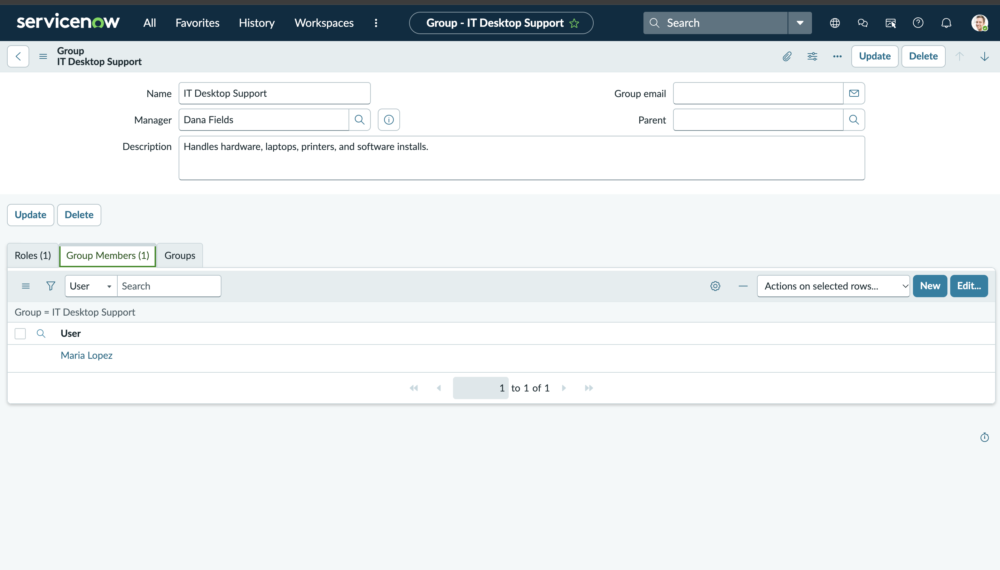
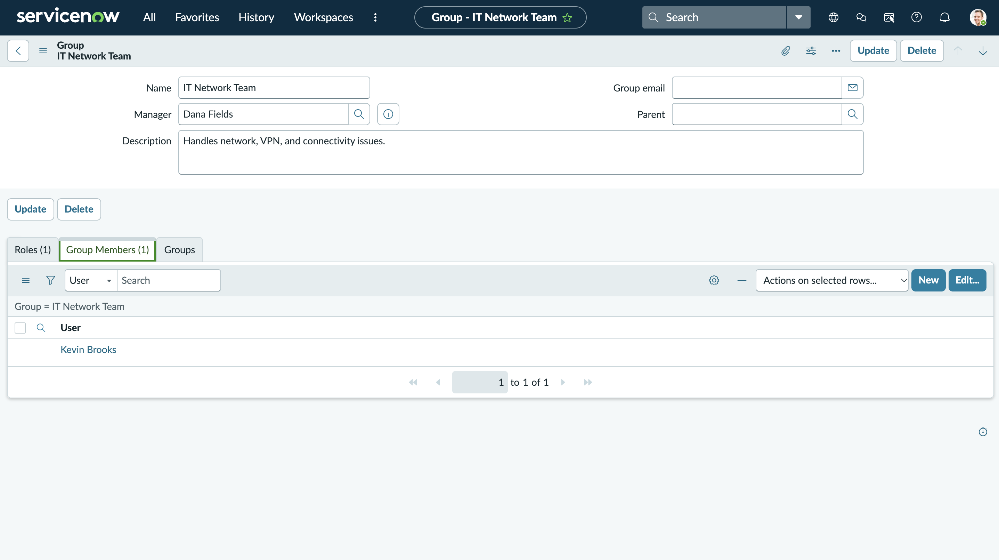
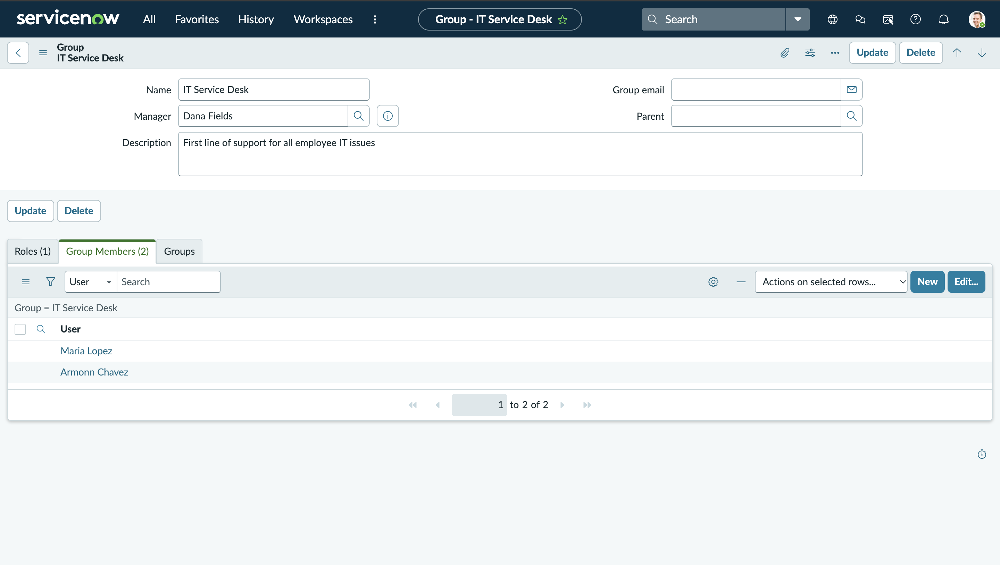

---

## Phase 2: Incident Management (6 Tickets)

### Ticket 1: Account Lockout (INC0010006)
**Scenario:** HR Coordinator locked out after multiple failed password attempts.
**Actions:** Verified identity, unlocked the account in the user record, forced a password reset at next login, and updated the caller.

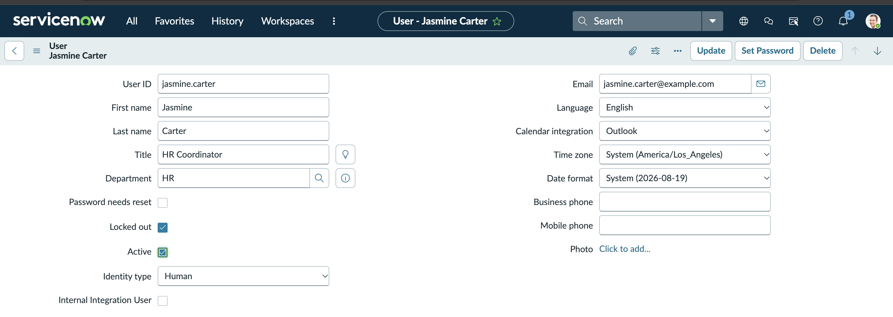
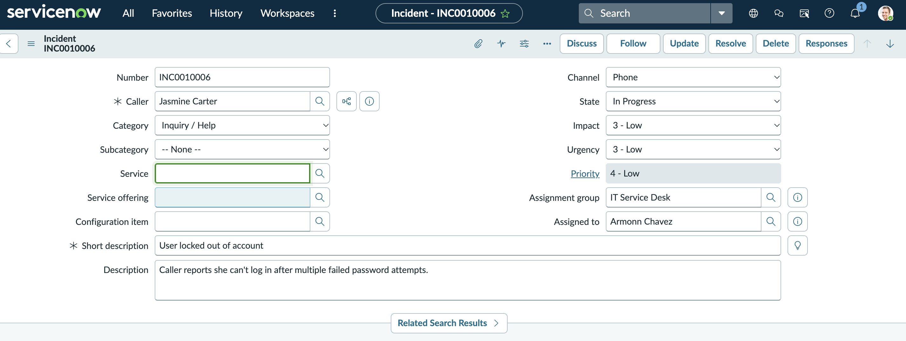
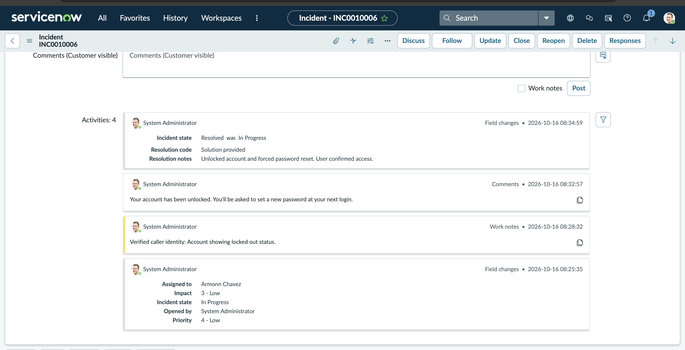
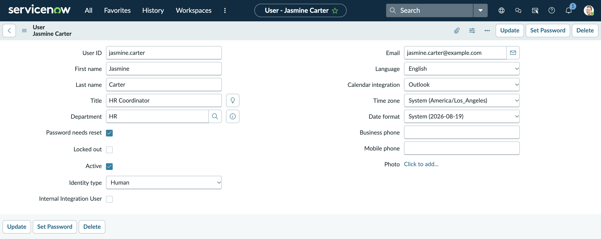
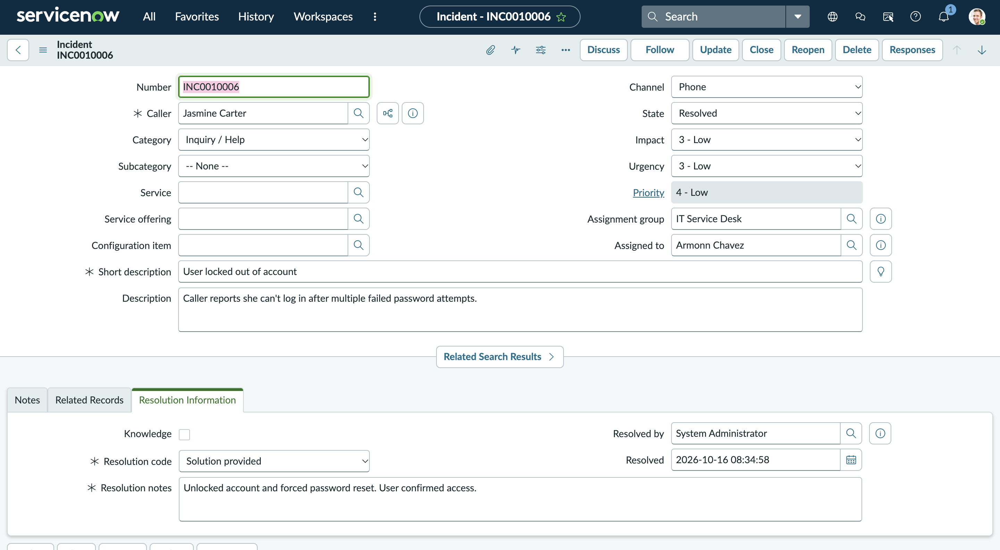

### Ticket 2: VPN Failure and Escalation (INC0010008)
**Scenario:** Remote user unable to connect to VPN.
**Actions:** Performed first-line troubleshooting (confirmed internet access, restarted the client, rebooted). Documented the steps and escalated to the IT Network Team. Used impersonation to resolve the ticket as the network admin.

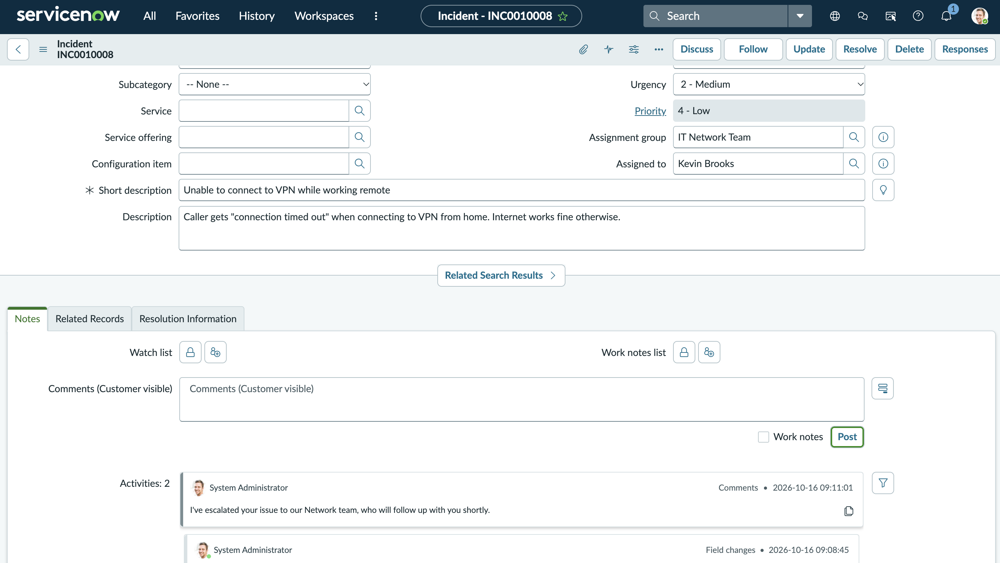
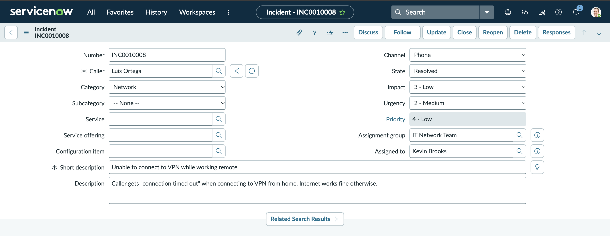

### Ticket 3: Printer Failure with CI and On Hold (INC0010010)
**Scenario:** Shared Sales printer showing a false paper jam.
**Actions:** Created the printer as a Configuration Item (SALES-PRINTER-01) and linked it to the ticket. Routed directly to Desktop Support, placed the ticket On Hold while awaiting a replacement part, and gave the user a workaround.

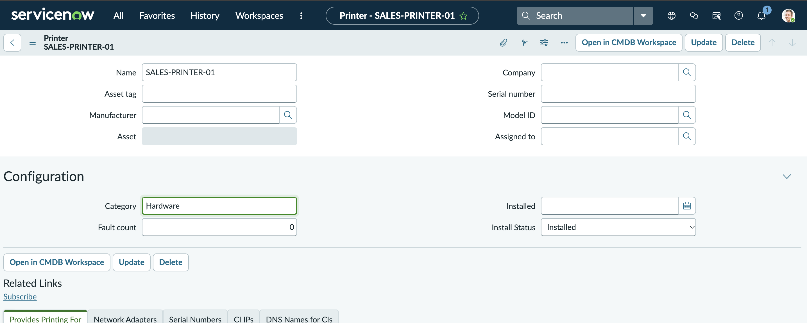

### Ticket 4: Incident vs. Request (INC0010011)
**Scenario:** User called in asking for Adobe Acrobat to be installed.
**Actions:** Identified this as a service request, not an incident. Ordered the catalog item on the user's behalf, resolved the incident with a reference to the request, and fulfilled the catalog task.

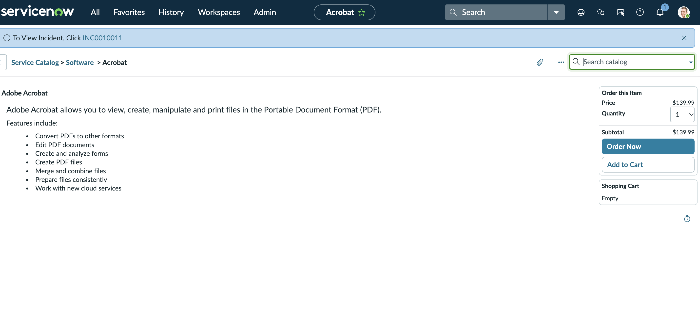
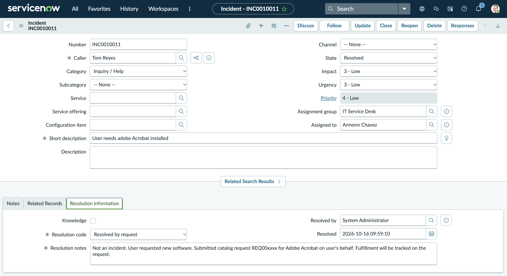

### Ticket 5: Outage with Parent/Child Incidents (INC0010012)
**Scenario:** Shared drive unreachable across multiple departments.
**Actions:** Created a Priority 1 parent incident and linked individual user reports as child incidents. Resolving the parent closed out the related reports, so every affected user was updated and no work was duplicated.

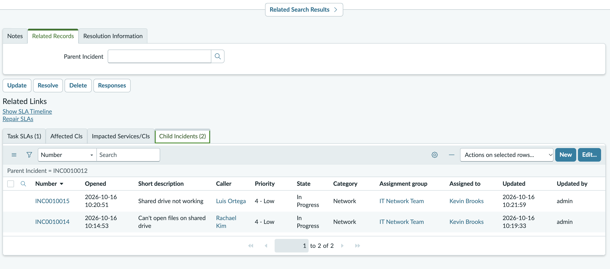

### Ticket 6: No Response from Caller (INC0010016)
**Scenario:** User reported Outlook crashing, then stopped responding.
**Actions:** Requested more information, set the ticket to On Hold (Awaiting Caller), made three documented contact attempts, then resolved it with clear notes that the user could reopen it.

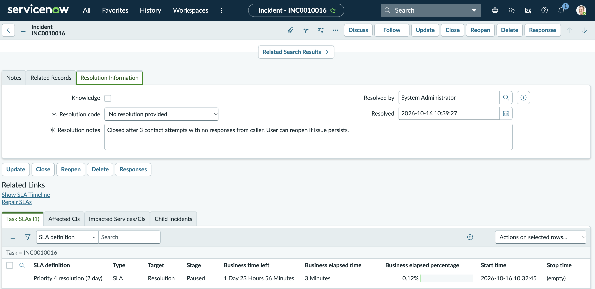

---

## Phase 3: Knowledge Management

Wrote and published **KB0010001: How to Unlock a Locked User Account**, based on Ticket 1. The article went through the IT knowledge base approval workflow before publishing.

---

## Phase 4: Reporting

Built reports on my lab tickets, filtered to the three IT assignment groups:
- Tickets by Priority
- Tickets by State
- Tickets by Assignment Group

---

## Key Takeaways

- **Documentation matters.** Clear work notes let the next agent pick up a ticket without repeating troubleshooting.
- **Keep the caller informed,** especially during escalations and holds.
- **Classify correctly.** Separating incidents from requests keeps metrics accurate and routes work to the right process.
- **Grant access through groups, not individuals.** It makes permissions easier to audit and manage.
